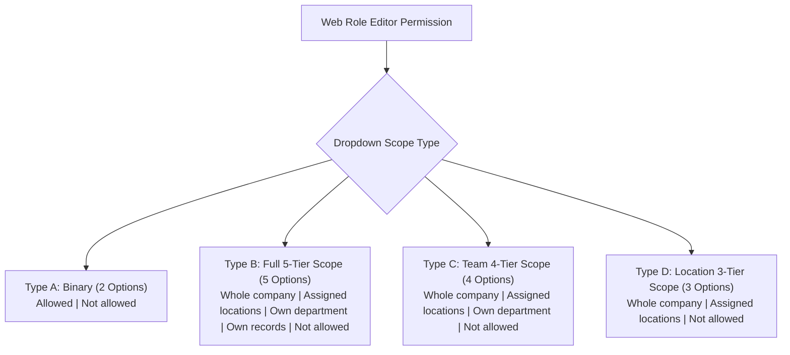

# AMS 2 — Master Permissions & Access Control Specification (RBAC Matrix)

> **Document Version:** 2.0.0 (Synchronized with AMS Web Admin Roles Engine, Dropdown Scope Menus & Mobile API v1)  
> **Source References:** Web Admin Role Editor Screens (`Edit Owner`), Dropdown Popups, `doc/api.md`, `GET /me` JSON Payload  
> **Target Audience:** Frontend Engineers (Flutter), Backend Engineers (Laravel), Product Owners, QA Engineers  

---

## 1. Core Architecture: How Permissions & Scopes Work

In AMS 2, access control is strictly **Permission-Driven & Scope-Based**. There are **no static roles** (like `if (role == 'admin')`) hardcoded in the Flutter client. 

### The 4 Dropdown Scope Types in Web Admin Panel
When assigning permissions in the Web Admin panel, the dropdown menu presents one of **4 distinct choice sets**:

#### 1. Type A: Binary Switch (2 Options)
* **Dropdown Choices:**
  - `Not allowed` $\rightarrow$ Key is completely omitted from the `permissions` dictionary (Access Denied `403`).
  - `Allowed` $\rightarrow$ `"key": null` in the `permissions` dictionary (Full Action Permitted).

#### 2. Type B: Full 5-Tier Scope (5 Options)
Used for personal and managerial items (e.g. Viewing Attendance, Payslips, Schedule, Employee Profile):
* **Dropdown Choices:**
  - `Whole company` $\rightarrow$ `"key": ["company"]`
  - `Assigned locations` $\rightarrow$ `"key": ["location"]`
  - `Own department` $\rightarrow$ `"key": ["department"]`
  - `Own records` $\rightarrow$ `"key": ["own"]`
  - `Not allowed` $\rightarrow$ Key omitted

#### 3. Type C: Team-Level 4-Tier Scope (4 Options)
Used for supervisory management where a person cannot manage themselves (e.g. Adding employees, Overriding approvals, Adjusting leave, Managing tasks):
* **Dropdown Choices:**
  - `Whole company` $\rightarrow$ `"key": ["company"]`
  - `Assigned locations` $\rightarrow$ `"key": ["location"]`
  - `Own department` $\rightarrow$ `"key": ["department"]`
  - `Not allowed` $\rightarrow$ Key omitted

#### 4. Type D: Branch-Level 3-Tier Scope (3 Options)
Used for physical facility or branch administration:
* **Dropdown Choices:**
  - `Whole company` $\rightarrow$ `"key": ["company"]`
  - `Assigned locations` $\rightarrow$ `"key": ["location"]`
  - `Not allowed` $\rightarrow$ Key omitted

---

### Scope Hierarchy & Inheritance Invariant
In AMS 2, permissions follow strict hierarchical inheritance:
$$\text{Whole company (company)} \supset \text{Assigned locations (location)} \supset \text{Own department (department)} \supset \text{Own records (own)}$$

* If an action requires `department` scope and user holds `Whole company`, the app automatically grants access (`AppPreferences.hasPermission(key, 'department') == true`).
* If an action is assigned `Not allowed`, the action button is **hidden from the UI**, and the server returns `403 forbidden` if invoked.

---

## 2. Master Permission Catalog with Dropdown Choices

---

### Category 1: Users & Roles
| UI Permission Label | Technical API Key | Dropdown Type & Available Choices | Mobile App Impact & Screen Mapping | Associated API Endpoints |
|---|---|---|---|---|
| **View roles** | `roles.view` | **Type A (Binary):** • `Allowed` • `Not allowed` | Allows viewing roles and permissions structure. (Web-admin module; mobile shows web portal guide). | Web Only |
| **Create, edit and delete roles** | `roles.manage` | **Type A (Binary):** • `Allowed` • `Not allowed` | Allows role definition and permission assignment. | Web Only |
| **View users** | `users.view` | **Type A (Binary):** • `Allowed` • `Not allowed` | Allows viewing system login accounts. | Web Only |
| **Enable, disable users and assign roles** | `users.manage` | **Type A (Binary):** • `Allowed` • `Not allowed` | Allows user activation, suspension, and role binding. | Web Only |

---

### Category 2: Company & Organisation
| UI Permission Label | Technical API Key | Dropdown Type & Available Choices | Mobile App Impact & Screen Mapping | Associated API Endpoints |
|---|---|---|---|---|
| **Edit the company profile, legal entities and settings** | `company.manage` | **Type A (Binary):** • `Allowed` • `Not allowed` | Admin access to edit legal name, company code, and addresses. | Web Only |
| **View locations, departments, designations and grades** | `organisation.view` | **Type A (Binary):** • `Allowed` • `Not allowed` | Allows browsing company hierarchy, offices, and job grades. | Web / Org Hub |
| **Change locations, departments, designations and grades** | `organisation.manage` | **Type A (Binary):** • `Allowed` • `Not allowed` | Allows adding or renaming branches, departments, or designations. | Web Only |

---

### Category 3: Employees (Directory & Profiles)
| UI Permission Label | Technical API Key | Dropdown Type & Available Choices | Mobile App Impact & Screen Mapping | Associated API Endpoints |
|---|---|---|---|---|
| **View employee profiles (job and contact)** | `employees.view` | **Type B (5-Tier):** • `Whole company` • `Assigned locations` • `Own department` • `Own records` • `Not allowed` | **Employees Directory (`EmployeesView`):** • `Own records`: Shows self only. • `Own department`: Shows team members. • `Assigned locations`: Shows branch staff. • `Whole company`: Shows everyone. | `GET /employees` `GET /employees/{id}` |
| **View ID documents, date of birth, address, emergency contacts and files** | `employees.sensitive.view` | **Type B (5-Tier):** • `Whole company` • `Assigned locations` • `Own department` • `Own records` • `Not allowed` | **Profile Tabs (`EmployeeDetailView`):** Shows/hides sensitive tabs (Personal Phone, Address, Emergency Contacts, Passport/Visa expiry dates). | `GET /employees/{id}` |
| **Add employees, edit their details and job, record leavers** | `employees.manage` | **Type C (4-Tier):** • `Whole company` • `Assigned locations` • `Own department` • `Not allowed` | Shows "+ Add Employee" button and allows editing employee job profile / contract details. | Web / Onboarding |
| **Manage employees' sign-in (invitations, sign-in email)** | `employees.accounts.manage` | **Type C (4-Tier):** • `Whole company` • `Assigned locations` • `Own department` • `Not allowed` | Allows sending app invitations, password resets, or changing login emails. | Web / Accounts |
| **Print employee ID cards and issue new ones** | `employees.cards.print` | **Type B (5-Tier):** • `Whole company` • `Assigned locations` • `Own department` • `Own records` • `Not allowed` | Enables viewing and printing digital employee ID cards with live QR tokens. | `GET /me/card` `GET /employees/{id}/card` |
| **Export the employee list** | `employees.export` | **Type C (4-Tier):** • `Whole company` • `Assigned locations` • `Own department` • `Not allowed` | Shows "Export Staff (CSV/Excel)" action button on Directory header. | `GET /employees/export` |

---

### Category 4: Attendance & Time Tracking
| UI Permission Label | Technical API Key | Dropdown Type & Available Choices | Mobile App Impact & Screen Mapping | Associated API Endpoints |
|---|---|---|---|---|
| **View attendance: punches, days, overtime** | `attendance.view` | **Type B (5-Tier):** • `Whole company` • `Assigned locations` • `Own department` • `Own records` • `Not allowed` | **Attendance Logs (`AttendanceHistoryView`):** • `Own records`: Personal logs & worked hours. • `Own department`: Team attendance audit. • `Whole company`: Company-wide attendance feeds. | `GET /me/attendance` `GET /employees/{id}/attendance` |
| **Correct attendance: add or void punches** | `attendance.manage` | **Type C (4-Tier):** • `Whole company` • `Assigned locations` • `Own department` • `Not allowed` | Allows approving missed punch correction requests or adding/voiding punches. | `POST /me/attendance/corrections` `POST /approvals/{id}/approve` |
| **Set up time and overtime policies and pay codes** | `attendance.setup` | **Type A (Binary):** • `Allowed` • `Not allowed` | Configures overtime formulas, late grace periods, and break rules. | Web Only |
| **Reset saved faces and kiosk PINs** | `attendance.face.manage` | **Type B (5-Tier):** • `Whole company` • `Assigned locations` • `Own department` • `Own records` • `Not allowed` | Resets facial recognition template or kiosk forgotten PIN. | `GET /me/face` `PUT /me/kiosk-pin` |
| **Set up and remove kiosk tablets** | `kiosks.manage` | **Type A (Binary):** • `Allowed` • `Not allowed` | **Tablet Kiosk Setup:** Allows signing in on a tablet and activating it as a permanent Biometric/QR Kiosk terminal (`POST /kiosks`). | `POST /kiosks` `GET /kiosk` |

---

### Category 5: Schedules & Duty Rotas
| UI Permission Label | Technical API Key | Dropdown Type & Available Choices | Mobile App Impact & Screen Mapping | Associated API Endpoints |
|---|---|---|---|---|
| **View rotas and schedules** | `schedules.view` | **Type B (5-Tier):** • `Whole company` • `Assigned locations` • `Own department` • `Own records` • `Not allowed` | **Schedule Screen (`ScheduleView`):** Shows duty shifts, off-days, and public holidays. | `GET /me/schedule` `GET /employees/{id}/schedule` `GET /holidays` |
| **Change rota days and assign work patterns** | `schedules.manage` | **Type C (4-Tier):** • `Whole company` • `Assigned locations` • `Own department` • `Not allowed` | Allows managers/HR to assign shift swaps or change rota patterns for staff. | Web / Rota Scheduler |
| **Set up shifts, break types, work patterns and holidays** | `schedules.setup` | **Type A (Binary):** • `Allowed` • `Not allowed` | Setup shift definitions (e.g. Day Shift 09-17) and company calendar holidays. | Web Only |

---

### Category 6: Requests & Approvals
| UI Permission Label | Technical API Key | Dropdown Type & Available Choices | Mobile App Impact & Screen Mapping | Associated API Endpoints |
|---|---|---|---|---|
| **Set up who approves which requests** | `approvals.manage` | **Type A (Binary):** • `Allowed` • `Not allowed` | Configures multi-tier approval chains (Manager $\rightarrow$ HR Officer $\rightarrow$ Director). | Web Only |
| **Approve or reject any waiting request, at any step** | `approvals.override` | **Type C (4-Tier):** • `Whole company` • `Assigned locations` • `Own department` • `Not allowed` | **Approvals Inbox (`ApprovalsInboxView`):** Enables **HR Override** button (`can.as_override: true`). Instantly approve/reject bypassing intermediate managers. | `GET /approvals` `POST /approvals/{id}/approve` `POST /approvals/{id}/reject` |

---

### Category 7: Leave Management
| UI Permission Label | Technical API Key | Dropdown Type & Available Choices | Mobile App Impact & Screen Mapping | Associated API Endpoints |
|---|---|---|---|---|
| **View leave: requests, balances, who is off** | `leave.view` | **Type B (5-Tier):** • `Whole company` • `Assigned locations` • `Own department` • `Own records` • `Not allowed` | **Leave Hub (`LeavesView`):** Shows leave balances, request history, and **"Who's Off"** calendar. | `GET /me/leave/balances` `GET /me/leave/requests` `GET /leave/whos-off` `GET /employees/{id}/leave` |
| **Enter and cancel leave for people, make requested days unpaid** | `leave.manage` | **Type C (4-Tier):** • `Whole company` • `Assigned locations` • `Own department` • `Not allowed` | Allows HR/Manager to enter leave on behalf of an employee or mark days unpaid. | `POST /me/leave/requests` `POST /me/leave/requests/{id}/cancel` |
| **Adjust leave balances (extra days, opening balances)** | `leave.adjust` | **Type C (4-Tier):** • `Whole company` • `Assigned locations` • `Own department` • `Not allowed` | Allows manual balance credit/deduction (e.g. +2 compensatory days). | Web / Leave Adjustments |
| **Set up leave types, policies and the leave year** | `leave.setup` | **Type A (Binary):** • `Allowed` • `Not allowed` | Defines Annual, Sick, Casual quotas and leave carry-over rules. | `GET /leave/types` |

---

### Category 8: Pay & Payroll
| UI Permission Label | Technical API Key | Dropdown Type & Available Choices | Mobile App Impact & Screen Mapping | Associated API Endpoints |
|---|---|---|---|---|
| **View pay** | `pay.view` | **Type B (5-Tier):** • `Whole company` • `Assigned locations` • `Own department` • `Own records` • `Not allowed` | **Payslips Screen (`PayrollView`):** `own` views personal payslips & salary breakdown; `company` views staff pay data. | `GET /me/payslips` `GET /me/payslips/{id}` `GET /me/salary` |
| **Change pay** | `pay.manage` | **Type A (Binary):** • `Allowed` • `Not allowed` | Modifies salary contracts, basic pay, and recurring allowances. | Web Only |
| **Run payroll: create, calculate, finalise and mark runs paid** | `payroll.run` | **Type A (Binary):** • `Allowed` • `Not allowed` | Triggers payroll execution and payslip finalisation. | Web Only |
| **Download bank files, the payroll journal and register** | `payroll.export` | **Type A (Binary):** • `Allowed` • `Not allowed` | Exports bank transfer files (WPS) and payroll tax journals. | Web Only |
| **Set up pay components, salary structures, pay schedules and accounts** | `payroll.setup` | **Type A (Binary):** • `Allowed` • `Not allowed` | Configures salary components, EOBI social security, and tax rules. | Web Only |

---

### Category 9: Loans, Advances & Expenses
| UI Permission Label | Technical API Key | Dropdown Type & Available Choices | Mobile App Impact & Screen Mapping | Associated API Endpoints |
|---|---|---|---|---|
| **View loans, advances and expense claims, and what is owed** | `money.view` | **Type B (5-Tier):** • `Whole company` • `Assigned locations` • `Own department` • `Own records` • `Not allowed` | **Loans & Expenses Screen (`MoneyRequestsView`):** Shows loan balances, repayment instalment plans, and claim history. | `GET /me/money-requests` `GET /me/money-requests/{id}` |
| **Enter money requests (approved at once), pay them out, change repayment plans, record repayments** | `money.manage` | **Type C (4-Tier):** • `Whole company` • `Assigned locations` • `Own department` • `Not allowed` | Approves staff loans, verifies expense receipts, records manual cash repayments. | `POST /me/money-requests` `POST /approvals/{id}/approve` |
| **Set up money request types, their limits, and expense categories** | `money.setup` | **Type A (Binary):** • `Allowed` • `Not allowed` | Defines loan limits, advance salary rules, and expense categories. | `GET /me/money-request-types` |

---

### Category 10: Performance Reviews
| UI Permission Label | Technical API Key | Dropdown Type & Available Choices | Mobile App Impact & Screen Mapping | Associated API Endpoints |
|---|---|---|---|---|
| **View performance reviews, goals and results** | `performance.view` | **Type B (5-Tier):** • `Whole company` • `Assigned locations` • `Own department` • `Own records` • `Not allowed` | **Performance Screen (`PerformanceView`):** Shows annual review cycles, goals, and evaluation forms. | `GET /performance/reviews` |
| **Run review cycles: reviewers, calibration, sharing results, pay proposals** | `performance.manage` | **Type C (4-Tier):** • `Whole company` • `Assigned locations` • `Own department` • `Not allowed` | Allows managers to submit ratings, verify figures, and recommend promotions/increments. | `GET /performance/reviews/{id}` `PUT .../answers` `POST .../submit` |
| **Set up rating scales and review forms** | `performance.setup` | **Type A (Binary):** • `Allowed` • `Not allowed` | Configures review scales (1-5), competency weights, and questionnaires. | Web Only |

---

### Category 11: Documents, Letters & News
| UI Permission Label | Technical API Key | Dropdown Type & Available Choices | Mobile App Impact & Screen Mapping | Associated API Endpoints |
|---|---|---|---|---|
| **View people's documents in categories shared with managers** | `documents.view` | **Type B (5-Tier):** • `Whole company` • `Assigned locations` • `Own department` • `Own records` • `Not allowed` | **Documents Hub (`DocumentsView`):** Access personal documents, contracts, and company policies. | `GET /me/documents` `GET /company-documents` |
| **Manage people's documents (every category), see what expires** | `documents.manage` | **Type C (4-Tier):** • `Whole company` • `Assigned locations` • `Own department` • `Not allowed` | Track expiring passports/visas company-wide and upload employee files. | `GET /me/documents/files/{id}` |
| **Set up document categories and the company library, see policy acknowledgements** | `documents.setup` | **Type A (Binary):** • `Allowed` • `Not allowed` | Upload company policies (e.g. Code of Conduct) and track digital sign-offs. | `POST /company-documents/{id}/acknowledge` |
| **Issue letters to people and see their letters** | `letters.issue` | **Type C (4-Tier):** • `Whole company` • `Assigned locations` • `Own department` • `Not allowed` | Generate official letters (Salary certificate, Experience letter) upon request. | `GET /letters/{id}` `GET /letters/{id}/pdf` `POST /me/letter-requests` |
| **Edit letter templates** | `letters.setup` | **Type A (Binary):** • `Allowed` • `Not allowed` | Create letterhead templates with dynamic merge tags (`{{name}}`, `{{salary}}`). | Web Only |
| **Publish announcements and company events** | `communication.manage` | **Type A (Binary):** • `Allowed` • `Not allowed` | Publish announcements on dashboard and schedule company events/milestones. | `GET /announcements` `GET /events` `GET /people/milestones` |

---

### Category 12: Onboarding, Checklists & Tasks
| UI Permission Label | Technical API Key | Dropdown Type & Available Choices | Mobile App Impact & Screen Mapping | Associated API Endpoints |
|---|---|---|---|---|
| **Give tasks to people and see their tasks** | `tasks.manage` | **Type B (5-Tier):** • `Whole company` • `Assigned locations` • `Own department` • `Own records` • `Not allowed` | **Tasks Hub (`TasksView`):** Shows "+ New Task" button to delegate tasks with due dates. | `GET /tasks` `POST /tasks` `POST /tasks/{id}/complete` |
| **Start and follow joiner and leaver checklists** | `onboarding.manage` | **Type C (4-Tier):** • `Whole company` • `Assigned locations` • `Own department` • `Not allowed` | **Onboarding Screen (`ChecklistsView`):** Track onboarding and offboarding exit tasks. | `GET /me/checklists` |
| **Set up joiner and leaver checklist templates** | `onboarding.setup` | **Type A (Binary):** • `Allowed` • `Not allowed` | Define standard steps for new hires (e.g. laptop handover, email creation). | Web Only |
| **Write job descriptions for designations** | `job_descriptions.manage` | **Type A (Binary):** • `Allowed` • `Not allowed` | Author job responsibilities and requirements for designations. | `GET /me/job-description` |

---

### Category 13: Assets & Training
| UI Permission Label | Technical API Key | Dropdown Type & Available Choices | Mobile App Impact & Screen Mapping | Associated API Endpoints |
|---|---|---|---|---|
| **View the company assets people hold** | `assets.view` | **Type B (5-Tier):** • `Whole company` • `Assigned locations` • `Own department` • `Own records` • `Not allowed` | **Assets Screen (`AssetsView`):** View assigned company laptops, phones, vehicles. | `GET /me/assets` |
| **Keep the asset register: add, give out and take back assets** | `assets.manage` | **Type C (4-Tier):** • `Whole company` • `Assigned locations` • `Own department` • `Not allowed` | Asset assignment, condition out/in, and receipt acknowledgement tracking. | `POST /me/assets/{id}/acknowledge` |
| **View training records** | `training.view` | **Type B (5-Tier):** • `Whole company` • `Assigned locations` • `Own department` • `Own records` • `Not allowed` | **Training Screen (`TrainingView`):** Check required compliance courses and certifications. | `GET /me/training` |
| **Record training and set up courses** | `training.manage` | **Type C (4-Tier):** • `Whole company` • `Assigned locations` • `Own department` • `Not allowed` | Add new training courses, record pass/fail results, and upload certificates. | Web / Training Admin |

---

### Category 14: HR Helpdesk & Support
| UI Permission Label | Technical API Key | Dropdown Type & Available Choices | Mobile App Impact & Screen Mapping | Associated API Endpoints |
|---|---|---|---|---|
| **Answer HR helpdesk tickets** | `helpdesk.handle` | **Type C (4-Tier):** • `Whole company` • `Assigned locations` • `Own department` • `Not allowed` | **Internal HR Helpdesk (`HelpdeskTicketView`):** HR/Admin replies to staff tickets. | `GET /helpdesk/tickets` `POST /helpdesk/tickets/{id}/messages` |
| **Set up HR helpdesk categories** | `helpdesk.setup` | **Type A (Binary):** • `Allowed` • `Not allowed` | Configures ticket categories (e.g. Payroll Query, Leave Issue). | `GET /helpdesk/categories` |
| **See support tickets** | `support.view` | **Type B (5-Tier):** • `Whole company` • `Assigned locations` • `Own department` • `Own records` • `Not allowed` | **AMS Support Screen (`SupportView`):** Views tickets raised with AMS development team. | `GET /support/tickets` `GET /support/tickets/{id}` |
| **Raise support tickets and reply** | `support.raise` | **Type A (Binary):** • `Allowed` • `Not allowed` | Enables "Open Ticket" and "Send Reply" buttons to AMS support. | `POST /support/tickets` `POST /support/tickets/{id}/replies` |

---

### Category 15: Biometric Devices & Reports
| UI Permission Label | Technical API Key | Dropdown Type & Available Choices | Mobile App Impact & Screen Mapping | Associated API Endpoints |
|---|---|---|---|---|
| **View biometric devices and change their settings** | `devices.manage` | **Type A (Binary):** • `Allowed` • `Not allowed` | Manages hardware biometric machines (ZKTeco, Hikvision) and sync status. | Web Only |
| **Open reports, custom reports and analytics** | `reports.view` | **Type A (Binary):** • `Allowed` • `Not allowed` | Access to view executive dashboards, headcounts, and turnover analytics. | Web / Mobile Phase 19 |
| **Have saved reports sent on a schedule** | `reports.schedule` | **Type A (Binary):** • `Allowed` • `Not allowed` | Automated email scheduling of payroll/attendance reports. | Web Only |

---

## 3. What Each Dropdown Choice Allows in the Mobile App

| Selected Choice | Backend Representation | Impact on Mobile App User Experience |
|---|---|---|
| **`Not allowed`** | Key omitted | Feature is completely hidden or returns `403 Forbidden` if opened directly. |
| **`Own records`** | `["own"]` | **Individual Employee View:** User can only view or act upon their **own record** (e.g., their own attendance, their own leave balance, their own payslip). |
| **`Own department`** | `["department"]` | **Department Manager View:** User sees all staff members belonging to the **departments they manage**. Approvals inbox shows pending requests from their direct subordinates. |
| **`Assigned locations`**| `["location"]` | **Branch / Facility Manager View:** User sees all employees assigned to the **workplace / branch locations** they supervise. Useful for multi-city enterprises. |
| **`Whole company`** | `["company"]` | **Super Admin / Executive View:** User sees **all employees across all branches and departments**. Unlocks HR Override, company-wide analytics, and universal approval powers. |
| **`Allowed`** | `null` | **Binary Action Granted:** Used for setup and operational actions (e.g., Kiosk Setup, Opening Support Tickets, Publishing Announcements). |
